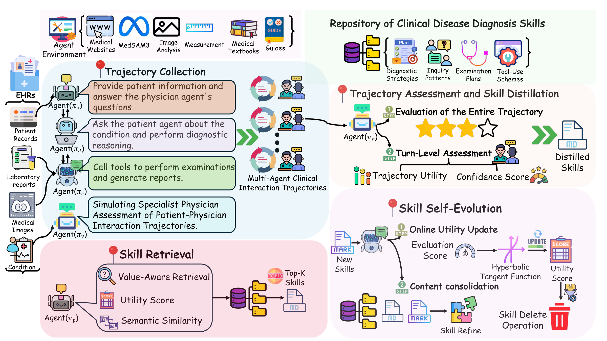

<div align="center">

# SkillEvo

### A Self-Evolving Diagnostic Skill System for Multi-Agent Clinical Reasoning

Learn from clinical interactions. Retrieve relevant experience. Refine skills over time.

**Selected source code and examples for peer review**

[Framework](#framework) · [Code](#repository-structure) · [Skill Examples](#skill-examples) · [Setup](#setup)

</div>

---

## Overview

SkillEvo develops reusable diagnostic skills from multi-turn clinical interactions. A physician agent gathers patient information, requests examinations, and updates its diagnostic hypotheses. Consultation trajectories are then assessed to distill skills, while relevant skills are retrieved at each turn to support subsequent reasoning. The external skill library evolves through feedback and content refinement, **without updating model weights**.

This repository provides a **partial source snapshot** of the paper's multi-agent system, together with the examples from the original review package. It focuses on consultation orchestration, skill extraction, retrieval, scoring, and library maintenance. The complete experimental runner and external services are not included.

## Framework

[](assets/framework_overview.png)

*Framework overview reproduced from the paper. Click the image to view it at full resolution.*

The framework connects four stages:

1. **Trajectory collection.** Physician, patient, examination, and evaluation roles form a multi-agent consultation environment. The physician follows a Think → Act → Observe loop, accumulating evidence through questions and examinations.
2. **Assessment and skill distillation.** Trajectory-level and turn-level assessment guide the extraction of reusable inquiry patterns, diagnostic strategies, examination plans, and tool-use experience.
3. **Skill retrieval.** Before each reasoning turn, the system selects relevant skill categories and retrieves candidates using the current evidence, differential diagnoses, semantic similarity, and skill confidence.
4. **Skill self-evolution.** Feedback updates skill utility. Related entries are compared for incremental consolidation, refinement, or separate retention, allowing the repository to develop over successive consultations.

The figure describes the full framework; this release contains the selected components listed below. Hidden reference diagnoses are used for offline supervision and must remain separate from the physician's online inputs.

## Repository structure

```text
SkillEvo/
├── src/
│   ├── agents/
│   │   ├── base_agent.py              # Shared agent and LLM interface
│   │   ├── doctor_agent.py            # Physician state and Think/Act/Observe prompts
│   │   └── patient_agent.py           # Responses based on patient-visible information
│   ├── orchestrator/
│   │   ├── react_loop.py              # Consultation loop and per-turn skill injection
│   │   └── message_bus.py             # Message routing and trajectory recording
│   └── skill_system/
│       ├── skill_math.py              # Confidence, retrieval, and feedback formulas
│       ├── skill_embedder.py          # Embedding cache and semantic retrieval
│       ├── skill_extractor.py         # Trajectory-based skill extraction
│       └── skill_library_manager.py   # Category buffers and incremental refinement
├── skills/                            # 20 examples from the original review package
│   ├── patient_inquiry.json
│   ├── diagnostic_reasoning.json
│   ├── exam_execution.json
│   └── diagnosis_conclusion.json
├── data/
│   ├── example_case.json              # Example case structure
│   └── resp_example_ct.png            # Image supplied with the original example
├── assets/
│   └── framework_overview.png         # Framework figure from the paper
└── requirements.txt
```

Examination/evaluation agents, permission and session management, complete training/evaluation scripts, model weights, and guideline indexes are outside this partial release. The code files shown here are retained from the original review package; this is not the later single-agent diagnosis-only implementation.

## Skill examples

Skills have two complementary descriptors: a **functional category** describing their role and an **abstraction level** describing their scope. L1 captures disease-specific experience, L2 captures reusable patterns within a clinical scenario, and L3 captures broad reasoning or workflow principles.

| Category | Role | Examples |
|---|---|---|
| Patient inquiry | Identify useful questions and fill information gaps | [5 skills](skills/patient_inquiry.json) |
| Diagnostic reasoning | Update hypotheses and select the next reasoning direction | [5 skills](skills/diagnostic_reasoning.json) |
| Examination execution | Guide examination selection and interpretation | [5 skills](skills/exam_execution.json) |
| Diagnosis conclusion | Synthesize findings and communicate diagnostic uncertainty | [5 skills](skills/diagnosis_conclusion.json) |

The English examples retain the original fields: `name`, `trigger`, `action`, `decision_rule`, `effect`, `pitfall`, `generalizable_to`, and associated metadata. For example:

> **Match Diagnostic Certainty to Evidence Strength — Never Overstate Confidence**<br>
> Category: `diagnosis_conclusion` · Level: `L3`<br>
> **Trigger:** Every time a diagnosis is formulated, whether final or interim, at any stage of the clinical encounter.

The [complete entry](skills/diagnosis_conclusion.json) describes how to distinguish a confirmed diagnosis from a provisional hypothesis, identify supporting and opposing evidence, and communicate what additional information would change the assessment.

All 20 entries are preserved from the original review package; no new skill examples have been substituted. Their stored scores, source counts, and intended effects are part of that snapshot and are not additional experimental results or independently validated clinical guidance.

## Example case

[`data/example_case.json`](data/example_case.json) illustrates the original case format with three information sections:

| Section | Intended recipient |
|---|---|
| `patient_visible` | Patient-side history, symptoms, and available vital signs |
| `exam_visible` | Examination-side reports and image references |
| `eval_hidden` | Offline reference diagnosis and assessment information |

The case and its accompanying image are supplied as originally packaged to illustrate the data interface. They are not a benchmark split or a validated end-to-end demonstration. The hidden section must not be passed to the physician during diagnosis.

## Setup

Python 3.10 or later is recommended. Install the dependencies from the repository root:

```bash
python -m pip install -r requirements.txt
```

The selected modules use an OpenAI-compatible chat interface and a BGE-M3 embedding service. Configure model endpoints and credentials in your own environment; no credentials or private deployment settings are supplied. The embedding module reads `BGE_M3_ENDPOINT`. The historical chat adapter uses Qwen-style request options, which may need adjustment for another provider.

This snapshot is intended for inspection of the method and its skill representation. Reproducing the full experiments requires the omitted system components, datasets, and evaluation configuration. Third-party datasets and models remain subject to their original terms; bibliographic details are omitted during anonymous review.
