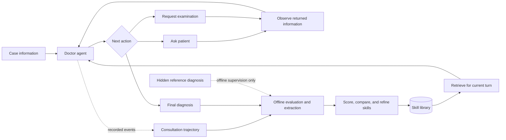

<div align="center">

# SkillEvo

### Self-Evolving Diagnostic Skills for Multi-Agent Clinical Reasoning

Reusable experience · Turn-aware retrieval · External skill evolution

**Partial source release for peer review** · Python 3.10+

[Overview](#overview) · [Quick start](#quick-start) · [Method](#how-the-system-works) · [Examples](docs/EXAMPLES.md) · [Release scope](docs/RELEASE_SCOPE.md)

</div>

---

## Overview

SkillEvo turns consultation trajectories into reusable diagnostic skills. A doctor agent gathers information through a patient agent and an examination agent, retrieves relevant experience before each reasoning turn, and records the consultation for offline evaluation and skill extraction. The resulting library evolves through confidence updates, semantic comparison, and incremental refinement, **without updating model weights**.

This repository contains selected modules from the paper's **multi-agent implementation**: the consultation loop, agent interfaces, extraction prompts, retrieval formulas, and library-management logic. It is a code-inspection artifact with an offline demonstration, **not the complete experimental runner**. Examination/evaluation agents, permission management, benchmark data, model weights, and experiment logs are outside this release. See [the module boundary](docs/RELEASE_SCOPE.md).

## How the system works



1. **Consult.** The doctor follows a Think → Act → Observe loop, with a default limit of eight turns. Questions and examination requests are routed through the message bus; returned information updates the doctor's state.
2. **Retrieve each turn.** A model selects relevant functional categories. The retriever embeds current evidence and differential hypotheses, filters by similarity, and ranks candidates using similarity and confidence. At most two skills per selected category are injected.
3. **Extract after the consultation.** The extractor uses the trajectory and optional hidden training reference to produce portable rules: when they apply, what to do, what to watch for, and how they generalize.
4. **Maintain the library.** Candidates accumulate in category buffers. Refinement compares them with related existing skills, allowing a merge, separate retention, or an abstraction-level upgrade. These are model decisions, not guaranteed outcomes.
5. **Update confidence.** Pure scoring functions define initial confidence, signed feedback adjustments, merge scores, and deprecation criteria. The full evaluation-and-update runner is not included here.

The reference diagnosis is offline supervision. It must not be supplied to the doctor during diagnosis. The loop expects a permission object; this partial release does not independently implement that access boundary.

## Quick start

From the repository root:

```bash
python -m venv .venv
source .venv/bin/activate
python -m pip install -r requirements.txt
python -m unittest discover -s tests -v
python -m examples.offline_walkthrough
```

On Windows, activate with `.venv\Scripts\Activate.ps1` instead.

The demonstration uses scripted responses to exercise the released message bus and ReAct loop. It prints a synthetic three-turn exchange, a selected skill's fields, and scoring values. **It makes no network calls, performs no learned retrieval or diagnosis, and reports no benchmark accuracy.** No API key is required.

For individual live components, see [interfaces and configuration](docs/ARCHITECTURE.md#external-services). The original adapter assumes an OpenAI-compatible backend with Qwen-style `chat_template_kwargs`; another provider may require adapting that request field.

## Skill representation

Functional category and abstraction level are separate axes:

| Functional category | Purpose |
|---|---|
| `patient_inquiry` | Ask targeted questions and fill information gaps |
| `diagnostic_reasoning` | Update hypotheses and choose the next diagnostic direction |
| `exam_execution` | Select or interpret examinations |
| `diagnosis_conclusion` | Synthesize evidence and express the final conclusion |

| Level | Intended scope |
|---|---|
| **L1** | Disease-specific experience |
| **L2** | Experience transferable within a clinical scenario |
| **L3** | Broad reasoning or workflow principles |

A skill carries `name`, `trigger`, `action`, `decision_rule`, `effect`, `pitfall`, and `generalizable_to`, plus category and level. Runtime records may add confidence, source counts, and provenance. The illustrated `effect` describes an intended benefit, not a measured outcome.

```json
{
  "category": "diagnosis_conclusion",
  "abstraction_level": "L3",
  "name": "Match diagnostic certainty to available evidence",
  "trigger": "When preparing the final diagnostic conclusion.",
  "action": "Separate observed findings, model interpretations, and unresolved assumptions.",
  "pitfall": "Presenting a plausible hypothesis as established without the necessary evidence."
}
```

This abbreviated illustration is expanded in [four English examples](docs/EXAMPLES.md). They explain the schema and are not evidence of clinical effectiveness.

## Scoring and retrieval

These equations describe the included snapshot. They are heuristic scores, not calibrated medical probabilities.

| Operation | Implemented rule |
|---|---|
| Initial confidence | `C₀ = 0.7 × E × 100 + 0.3 × g(level)` |
| Level prior | `g(L1)=50`, `g(L2)=70`, `g(L3)=100` |
| Lesson-mode adjustment | `C₀ × (0.4 + 0.6 × E)` |
| Feedback adjustment | `Δ = 5 × tanh(2 × impact)` |
| Retrieval ranking | `R = 0.5 × cosine + 0.5 × confidence / 100` |
| Merge score | `mean(source_scores) + min(3, 0.5 × source_count)`, capped at 100 |

| Setting | Snapshot default |
|---|---:|
| Consultation turn limit | 8 |
| Category buffer size before refinement | 5 |
| Similar existing skills considered for a merge | 2 |
| Merge-candidate cosine threshold | 0.55 |
| Retrieval cosine threshold | 0.50 |
| Retrieval ranking threshold | 0.25 |
| Maximum injected skills per selected category | 2 |
| Success-mode evaluation threshold | 0.70 |
| Skip-mode evaluation threshold | 0.30 |

The level prior affects initial confidence; this retriever does not multiply ranking by a separate level weight. There is no fixed L1/L2/L3 injection quota. See [implementation details and limitations](docs/ARCHITECTURE.md).

## Repository map

```text
.
├── src/
│   ├── agents/             # Base, doctor, and patient agents
│   ├── orchestrator/       # ReAct consultation loop and message bus
│   └── skill_system/       # Extraction, embeddings, scoring, and refinement
├── skills/                 # Four English schema illustrations
├── data/example_case.json  # Synthetic, text-only interface fixture
├── examples/               # Offline scripted walkthrough
├── tests/                  # Network-free component checks
├── docs/                   # Architecture, examples, and release boundary
├── .env.example            # Placeholder service configuration
└── requirements.txt
```

## Scope and interpretation

The examples and tests make the interfaces inspectable. They do not reproduce full experiments, establish clinical safety, or demonstrate an accuracy improvement. No benchmark images, clinical records, trained skill banks, private endpoints, credentials, or internal run artifacts are distributed. This snapshot preserves the historical multi-agent method; it does not mix in subsequent single-agent differential-diagnosis experiments.

Public datasets and third-party models remain subject to their original terms. This snapshot does not add a software license or grant rights to external data. Bibliographic metadata is omitted during anonymous review.
